<p align="center">
  
</p>

<h1 align="center">Zentral Extended</h1>

<p align="center">
  <strong>More ways to use panels, tabs and video in <a href="https://zen-browser.app">Zen Browser</a>.</strong><br />
  Keep your everyday sites close, arrange panels around your browsing, and choose how much of the interface you see.
</p>

<p align="center">
  
  
  <a href="https://github.com/sineorg/sine"></a>
  <a href="../LICENSE"></a>
</p>

<p align="center">
  <a href="#-install-only-what-you-need">Standalone modules</a> ·
  <a href="#-full-pack-installation">Full pack</a> ·
  <a href="#-features">Features</a> ·
  <a href="#-settings">Settings</a> ·
  <a href="#-compatibility">Compatibility</a> ·
  <a href="#-reporting-problems">Report a problem</a>
</p>

---

Zentral Extended builds on [Zentral by Michele501st](https://github.com/Michele501st/Zentral-Sine). The Zentral 1.1.0 base provides the core Apps grid, floating side panels, tab groups, color picker, diagnostics and settings UI. Extended adds flexible panel layouts, sidebar integrations, video previews and appearance controls on top of that foundation.

## 🧩 Install only what you need

You do **not** have to install everything. Eight features and the sidebar video preview can be installed on their own, straight from this repository, without the base Zentral Apps/Groups code. Pick the ones you want and skip the rest.

### How to install a single module

1. **Install [Sine](https://github.com/sineorg/sine)** (2.3 or newer) for Zen Browser.
2. In Sine's settings, enable **JavaScript from unofficial sources** (`sine.allow-unsafe-js`). Without it Sine downloads the mod but never runs its script.
3. Open **Zen Settings → Sine Mods**, paste the module's **install URL** from the table below and install it.
4. **Restart Zen.** Settings for the module appear in Sine's preferences for that mod.

Sine pulls later updates from this repository; every change raises the module's `version`.

### Available standalone modules

| Module | What it does | Install URL |
| --- | --- | --- |
| **[Sidebar Video Preview](https://github.com/bgalazka186/Zentral-Sine-extended/tree/main/additional/video)** | Shows a playing video from any tab in the sidebar. Play/pause, mute, seek and resize it, show mirrored subtitles, and double-click to enlarge it into a draggable, resizable Big Preview. | `https://github.com/bgalazka186/Zentral-Sine-extended/tree/main/additional/video` |
| **[Notes (no encryption, first implementation)](https://github.com/bgalazka186/Zentral-Sine-extended/tree/main/additional/notes)** | Quick notes that open over the panel you are using: several notes, highlights, checklists, search, trash and Save to file. Stored as plain Markdown files, not in preferences. | `https://github.com/bgalazka186/Zentral-Sine-extended/tree/main/additional/notes` |
| **[RSS Display](https://github.com/bgalazka186/Zentral-Sine-extended/tree/main/additional/rss)** | Cleaner display for Zen live-folder RSS items, plus a hover reader card with Open, Dismiss and Dismiss all. | `https://github.com/bgalazka186/Zentral-Sine-extended/tree/main/additional/rss` |
| **[Library Resize](https://github.com/bgalazka186/Zentral-Sine-extended/tree/main/additional/library)** | Makes Zen's native Library behave like a side panel: overlay the page or resize it, with an optional custom (or Arc 2.0-matched) Library background. | `https://github.com/bgalazka186/Zentral-Sine-extended/tree/main/additional/library` |
| **[Tab Unload](https://github.com/bgalazka186/Zentral-Sine-extended/tree/main/additional/tabs/unloading)** | Middle-click a loaded tab to unload it instead of closing it. Already unloaded tabs close normally. | `https://github.com/bgalazka186/Zentral-Sine-extended/tree/main/additional/tabs/unloading` |
| **[Background Tab Drag](https://github.com/bgalazka186/Zentral-Sine-extended/tree/main/additional/tabs/dragging)** | Reorder background tabs, folders and split-view groups without switching to them first. | `https://github.com/bgalazka186/Zentral-Sine-extended/tree/main/additional/tabs/dragging` |
| **[Load Tab at Startup](https://github.com/bgalazka186/Zentral-Sine-extended/tree/main/additional/tabs/startup)** | Adds a tab context-menu item to load a tab at startup, separately from panel preloading. | `https://github.com/bgalazka186/Zentral-Sine-extended/tree/main/additional/tabs/startup` |
| **[Compact Sidebar Hover](https://github.com/bgalazka186/Zentral-Sine-extended/tree/main/additional/tabs/compact-hover)** | Optional compact-sidebar helpers: extra edge tolerance, reveal on window entry and startup width recalculation. | `https://github.com/bgalazka186/Zentral-Sine-extended/tree/main/additional/tabs/compact-hover` |
| **[Logger](https://github.com/bgalazka186/Zentral-Sine-extended/tree/main/additional/diagnostics)** | Diagnostic logger with **Alt+L** export for Zentral and Zen layout issues. Useful when reporting bugs. | `https://github.com/bgalazka186/Zentral-Sine-extended/tree/main/additional/diagnostics` |

> **Good to know**
> - **Full pack wins.** If you later install the full pack too, it takes over these features and the standalone copy releases itself, so nothing is hooked twice. Both use the same preference keys, so your settings carry over.
> - **Not standalone:** the [adaptive theme service](https://github.com/bgalazka186/Zentral-Sine-extended/tree/main/additional/theme) needs the module loader, and the panels, Apps, Groups and Appearance features need the full pack.
> - **Testing status:** the standalone packages are unit-tested with a simulated browser window and are not yet verified through a real Sine install. If one misbehaves, please [report it](#-reporting-problems).

## 📦 Full pack installation

**[Sine](https://github.com/sineorg/sine) is required.** Install Extended as one mod to get everything below.

1. Open **Zen Settings → Sine Mods**.
2. Add this repository:

   ```text
   https://github.com/bgalazka186/Zentral-Sine-extended
   ```

3. Install **Zentral Extended**.
4. Restart Zen.

Disable the separate original Zentral mod when using Extended, because both provide the core Zentral functionality. Applying a changed-files ZIP instead? See [INSTALL.md](../INSTALL.md).

<details>
<summary><strong>About the screenshots</strong></summary>

Screenshots in this README are captured with other Sine mods installed alongside Extended (see [Compatibility](#-compatibility)). Some UI elements you see may come from those mods rather than from Extended itself.

</details>

## ✨ Features

Items marked 🧩 are available as [standalone modules](#-install-only-what-you-need).

### Panels and layouts

The Zentral 1.1.0 base already provides apps, panels, pin/unpin, detachable floating panels, drag resizing, workspace isolation, notification badges, background preloading and panel animation. Extended adds:

| Feature | What it does |
| --- | --- |
| **Webpage Push** *(Dual View)* | Pushes the webpage aside and links a panel beside it. |
| **Triple View** | Links three panels side by side. |
| **SuperPin** | Keeps a separate, movable second panel pinned in place, beyond the base pin/unpin behavior. |
| **Autohide enhancements** | Adjustable activation area and delays on top of the base autohide. |
| **Pill controls** | Choose the layout, hide individual buttons, adjust position and opacity, or use a small idle indicator. |
| **Panel navigation** | Back/forward, Reload/Stop, an editable URL/search bar, quick-switch search targets and saved start URLs. |
| **Startup choices** | Preload selected apps or open a panel or linked Triple View. Smart Sleep delays automatic preloading without clearing your selections. |
| **Audio controls** | Optional notification and audio indicators with quick mute controls. |
| **Containers and mobile mode** | Pick a Firefox Container or request a mobile version of a site. Site support varies. |

<table>
  <tr>
    <td align="center">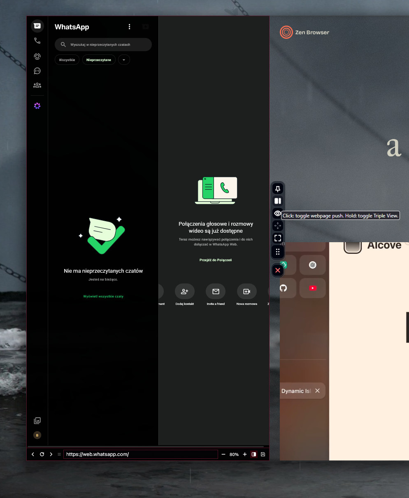<br /><sub>Webpage Push</sub></td>
    <td align="center">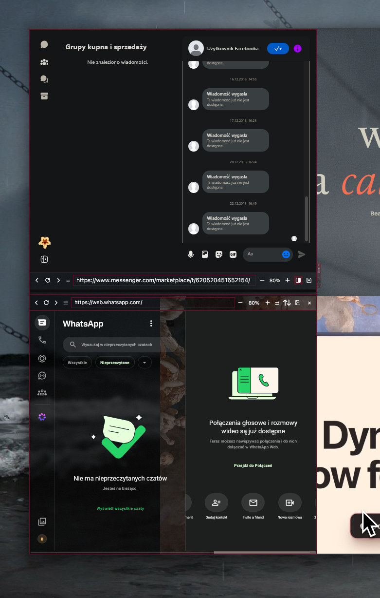<br /><sub>Triple View</sub></td>
    <td align="center"><br /><sub>SuperPin</sub></td>
  </tr>
  <tr>
    <td align="center"><br /><sub>Autohide</sub></td>
    <td align="center">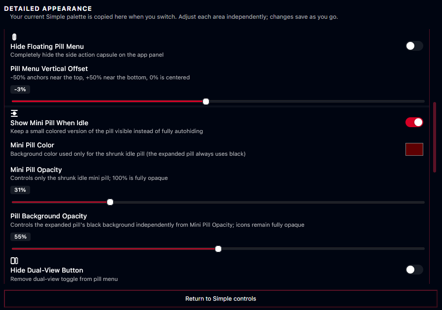<br /><sub>Pill controls</sub></td>
    <td align="center">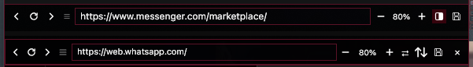<br /><sub>Navigation</sub></td>
  </tr>
  <tr>
    <td align="center">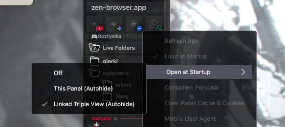<br /><sub>Startup choices</sub></td>
    <td></td>
    <td></td>
  </tr>
</table>

### Tabs and sidebar

The Zentral 1.1.0 base already provides tab groups with colors, indicators and nesting, plus the apps sidebar grid. Extended adds:

| Feature | What it does |
| --- | --- |
| **Panels on Essential tabs** | Optional corner launchers, hover-only tiles and notification badges. |
| **Open tabs as panels** | Favicon launchers open a tab's page inside a panel. |
| 🧩 [**Drag without activating**](https://github.com/bgalazka186/Zentral-Sine-extended/tree/main/additional/tabs/dragging) | Reorder background tabs, folders and split-view groups while keeping the current tab active. |
| 🧩 [**Middle-click to unload**](https://github.com/bgalazka186/Zentral-Sine-extended/tree/main/additional/tabs/unloading) | Unload a loaded normal tab instead of closing it. |
| 🧩 [**Native-tab startup loading**](https://github.com/bgalazka186/Zentral-Sine-extended/tree/main/additional/tabs/startup) | Opt-in loading for Essential and pinned browser tabs, separate from panel preloading. |
| **Sidebar density** | Adjust row heights, spacing, Essentials sizing, icons and smaller controls. |
| 🧩 [**Compact sidebar helpers**](https://github.com/bgalazka186/Zentral-Sine-extended/tree/main/additional/tabs/compact-hover) | Compact mode with a thicker sidebar, edge tolerance and reveal on window entry. |
| 🧩 [**RSS reader card**](https://github.com/bgalazka186/Zentral-Sine-extended/tree/main/additional/rss) | Hover a live-folder article to read it in a card; colors, size, radius, transparency and text size are adjustable. |
| **Hide unattached app controls** | Hides the standalone apps box while a workspace has no apps and shows it again as soon as one is available. Also found in **Start here**. |
| **Optional integrations** | Extra behavior for Arc 2.0, Zen Library and RSS live folders. |

<table>
  <tr>
    <td align="center">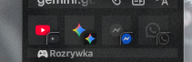<br /><sub>Panels on Essential tabs</sub></td>
    <td align="center"><br /><sub>Open tabs as panels</sub></td>
    <td align="center">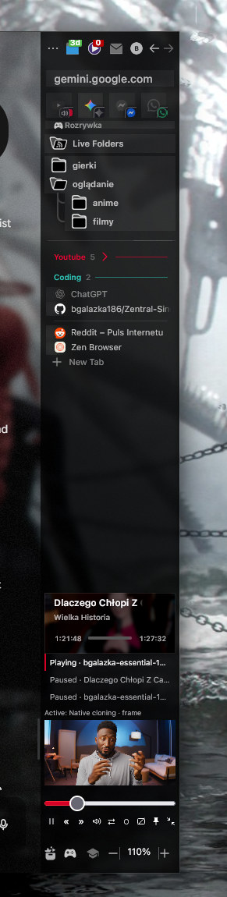<br /><sub>Sidebar density</sub></td>
  </tr>
  <tr>
    <td align="center">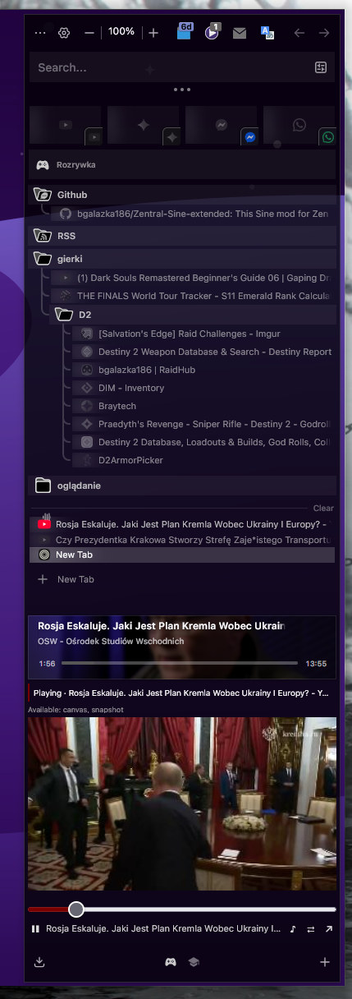<br /><sub>Compact sidebar</sub></td>
    <td align="center">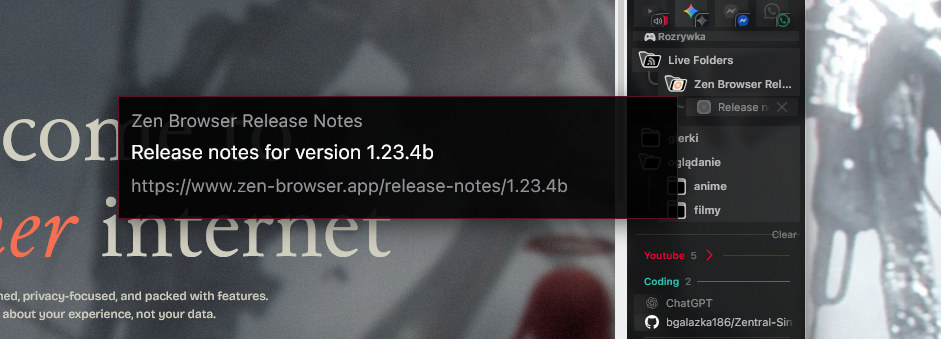<br /><sub>RSS reader card</sub></td>
    <td></td>
  </tr>
</table>

### 🧩 Notes

[Notes](https://github.com/bgalazka186/Zentral-Sine-extended/tree/main/additional/notes) is a quick-note sheet that opens over the panel you are using. A **note button sits at the far left of the panel URL bar** (and of the Triple View / Super Pin bars), so in Triple View you can open a note from one bar and keep reading the other panel. The panel's page is never navigated, moved or unloaded.

- **Multiple notes** with search, pinning, colors and a Trash that keeps deleted notes for 30 days. The first line is the title.
- **Same notes everywhere:** every sheet shows the same note, live, across panels and across Zen windows.
- **Highlights** in five colors, bold, italic, strikethrough, headings, bullet lists and **checklists** you can tick in read mode.
- **Save to file…**, copy, duplicate and export all.
- **Safe autosave:** saves shortly after you stop typing and at least every few seconds while you keep typing, so a crash costs seconds.
- **Not stored in preferences:** each note is a plain `.md` file in a folder of your profile (or one you choose), written atomically with a backup copy. Open that folder in Obsidian or sync it with Syncthing if you like.
- Uses the **panel black backing** and your Look colors. Shortcut: **Alt+Shift+N** (changeable).

### 🧩 Zen Library integration

[Library Resize](https://github.com/bgalazka186/Zentral-Sine-extended/tree/main/additional/library) makes Zen's native Library behave more like a Zentral panel. It is independent of the Zentral Apps/Groups base.

| Option | Default | Notes |
| --- | --- | --- |
| **Make Library behave more like Zentral panel** | Off (on in Recommended) | Keeps Library's own animation and suppresses native content, toast and toolbox translation/fading. |
| **Layout mode** | Resize webpage | *Resize* reserves space inside the tabbox; *Overlay* (Recommended) covers the page without changing its width. |
| **Minimum webpage width** | 200 px | 0–1000 px, Resize mode only. Library may overlap content on narrow windows. |
| **Resize continuously during animation** | Off | When on, follows the animated edge; heavy sites may do more layout. |

Library sits beside the native sidebar on either side, stays anchored at the bottom, and closes when you click the webpage or press Escape.

<p align="center">
  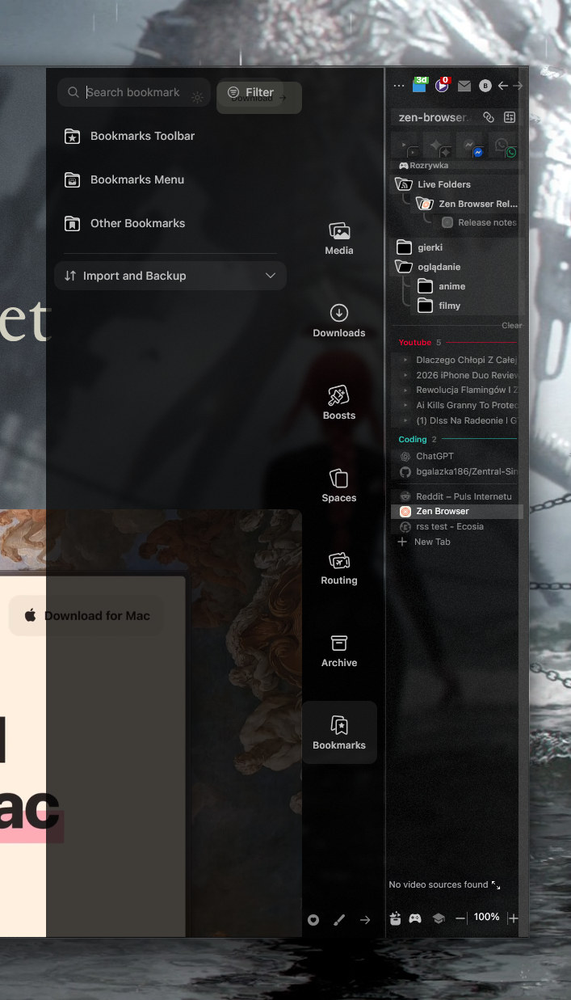
</p>

### 🧩 Sidebar video and Big Preview

The [sidebar video preview](https://github.com/bgalazka186/Zentral-Sine-extended/tree/main/additional/video), capture system and Big Preview player are Extended additions, inspired by [Zenslop](https://github.com/Firebolt9907/Zenslop). They are not part of the Zentral 1.1.0 base.

**Sidebar playback:** choose or pin a video source from tabs or panels, play/pause, mute, seek and resize the preview.

<p align="center">
  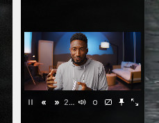
</p>

**Big Preview:** double-click the video to enlarge it, drag it around, and resize from any edge or corner. Double-click again, use the Return control, or press Escape to return to the sidebar.

<p align="center">
  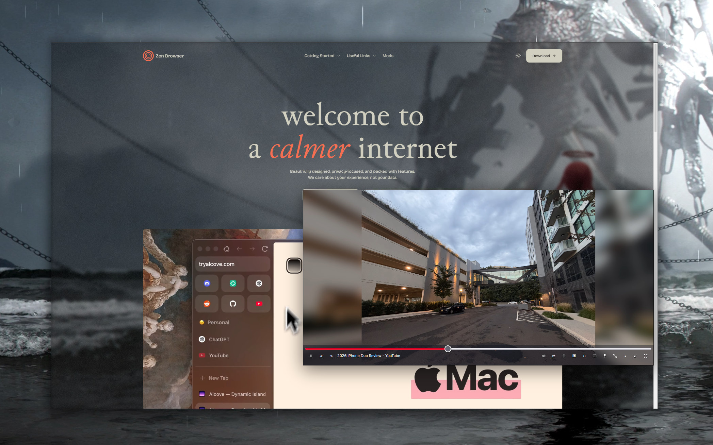
</p>

- **Click to play/pause:** click the enlarged video once to toggle playback.
- **Video proportions:** keep the aspect ratio while resizing, or disable the lock. Size is remembered; remembering the position is optional.
- **Hover controls:** playback controls and the progress bar appear over the bottom of the video.
- **Compact sidebar controls:** one row with adjustable spacing, and an option to allow a second row.
- **Appearance integration:** buttons follow the selected palette, button style, borders and opacity.
- **Insta Peek:** hold **Alt+Q** to temporarily hide Big Preview and interact with what is underneath.
- **Subtitles:** mirror supported captions below the image or over the video, with adjustable size, line count and overflow behavior.
- **Capture choices:** native visual cloning where supported, video frames, streams, canvas streams and page snapshots.
- **Fallback and performance controls:** automatic fallback, capture resolution and frame rate, and reduced work while the preview is hidden.

<p align="center">
  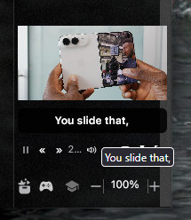
</p>

<details>
<summary><strong>Big Preview keyboard controls</strong></summary>

These shortcuts apply while Big Preview has focus.

| Key | Action |
| --- | --- |
| Space / K | Play or pause |
| M | Mute or unmute |
| F | Toggle preview fullscreen |
| J / L | Seek backward / forward 10 seconds |
| Left / Right | Seek backward / forward 5 seconds |
| Up / Down | Increase / decrease volume |
| 0–9 | Seek to 0–90% of the video |
| Home / End | Seek to the beginning / end |
| < / > | Decrease / increase playback speed |
| C | Toggle mirrored preview captions |
| I / Escape | Return to the sidebar |

Keyboard shortcuts and image-click playback can be disabled separately. Text fields, buttons and the seek slider keep their own keyboard behavior.

</details>

Big Preview is an in-browser player. Capture support, captions and playback commands can vary by site and Zen version. It is still being refined.

### Appearance

The appearance system (palettes, translucency, Atelier/Classic settings) is an Extended addition and is not part of the Zentral 1.1.0 base.

- **Starting styles:** Default, Paper, Transparent, Tide and Blueprint, with additional variants where available.
- **Transparency theme:** panels and controls use dynamic translucency so changing content shows through behind them.
- **Simple and Detailed palettes:** start with a few linked colors or fine-tune individual surfaces and controls.
- **Automatic or manual text colors:** automatic contrast, or your own colors in Detailed mode.
- **Control styling:** button styles, borders, corner radius, spacing and size.
- **Dynamic translucency:** separate opacity for unpinned, pinned-and-focused, and pinned-but-unfocused panels.
- **Settings interface:** choose between the Atelier and Classic settings look.

<p align="center">
  
</p>

> Transparent surfaces reveal changing content behind them. If controls become hard to read, increase their backing opacity or choose filled buttons.

## ⚙️ Settings

Open Extended Settings with **Ctrl+Alt+=**. Settings are grouped by the feature they affect:

| Group | Contents |
| --- | --- |
| **Start here** | Main feature switches, plus quick access to **Hide Unattached App Controls**. |
| **Panels** | Placement, resizing, navigation and behavior. |
| **Tabs and sidebar** | Launchers, density and optional integrations. |
| **Video** | Capture methods, playback, captions and Big Preview. |
| **Appearance** | Palettes, button styling, spacing and transparency. |
| **New settings · 3.0+** | Grouped copies of recently added controls. |

A setting and its copy in **Start here** or **New settings** edit the same preference. For sidebar video layout, open **Appearance → Sidebar video** in Detailed mode.

**Recommended setup.** A portable starting point, applied only when you choose it; updating never resets your preferences. It excludes personal app lists, account details, custom URLs and machine-specific paths. Back up your configuration first if you want to keep your current setup.

## 🤝 Compatibility

I use Extended every day alongside the Sine mods below, and for me they work fine together. That is my own setup, not a guarantee: results can differ with other versions, settings or mods (**your mileage may vary**).

| Mod | Author | How it fits with Extended |
| --- | --- | --- |
| [Arc 2.0](https://github.com/YashjitPal/Arc-2.0) | YashjitPal | Extended has optional appearance settings that follow it, such as matching the Library color. It is not installed for you. |
| [Tab Groups](https://github.com/oom333/zen-tab-groups) | oom333 | What I use for tab grouping, with Zentral Groups turned off. |
| [ZenLibraryTweaks](https://github.com/JustAdumbPrsn/ZenLibraryTweaks) | JustAdumbPrsn | If you use its Library layout, turn on *external Library layout* so Extended's Library geometry pauses. |
| [Zen Folder Tree Connectors](https://github.com/JustAdumbPrsn/ZenFolderTreeConnectors) | JustAdumbPrsn | Installed alongside, with no special setup on my side. |
| [Transparent Zen](https://www.sameerasw.com/zen) | sameerasw | Installed alongside, with no special setup on my side. |
| [Customize Font Size](https://github.com/joadr/zen-customize-fonts-size) | joadr | Installed alongside, with no special setup on my side. |
| better-ctrl-tab | psu | Installed alongside, with no special setup on my side. |

If something looks wrong with another mod, try turning off the overlapping feature in one of the two. Avoid running several features that manage the same layout or interaction, and enable individual compatibility options only when you need them. Found a conflict? Please [open an issue](https://github.com/bgalazka186/Zentral-Sine-extended/issues).

## 🏗️ Architecture and updates

Extended 3.1.3 uses Zentral 1.1.0 as its core reference. Original-derived code, Extended integrations and independent features live in separate areas:

| Location | Purpose |
| --- | --- |
| [`loader/`](../loader) | Loading, lifecycle management and shared runtime services |
| [`zentral/`](../zentral) | Original-derived Apps and Groups implementation |
| [`extension/`](../extension) | Zentral-dependent enhancements and settings |
| [`additional/`](../additional) | Independent features, including video and optional integrations |

Optional features fail independently: a missing file or failed initialization is reported without taking down unrelated functionality.

Release and install notes for each module are in its own folder README.

## 🐛 Reporting problems

Please [open an issue](https://github.com/bgalazka186/Zentral-Sine-extended/issues) and include:

You can also do it from inside Zen: open Extended Settings, go to **Diagnostics → Report an Issue** and pick where the report goes. **Zentral Extended** (the default) opens a pre-filled page on this repository and uploads nothing until you submit it yourself. **Original Zentral base** is only for bugs in the original mod. The attached log is redacted first (URL queries, user names in file paths, emails and tokens are removed), but please read it before posting.

- Your Zen and Zentral Extended versions, and whether you use the full pack or a standalone module.
- The steps needed to reproduce the problem, and whether it happens in a fresh profile.
- Relevant appearance, video or compatibility settings, and any errors from the Browser Console. The [Logger](https://github.com/bgalazka186/Zentral-Sine-extended/tree/main/additional/diagnostics) can export a report with **Alt+L**.

For sidebar resizing problems, mention whether the sidebar is on the left or right and whether Compact Mode is enabled. For video problems, mention the site, capture method and whether sidebar playback, Big Preview or both are affected. Remove personal URLs and account details before sharing logs.

## 🖼️ Gallery

<p align="center">
  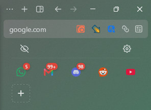
  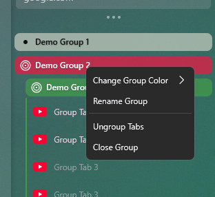
  
  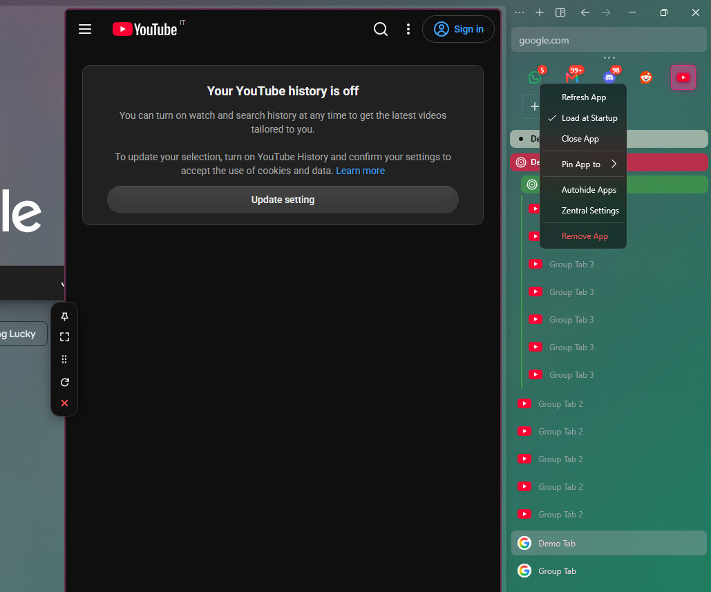
</p>

<p align="center">
  
  
</p>

## 💜 Credits

- [Michele501st](https://github.com/Michele501st) for [Zentral](https://github.com/Michele501st/Zentral-Sine)
- [Zenslop](https://github.com/Firebolt9907/Zenslop) for the sidebar video preview inspiration.
- The [Zen Browser](https://zen-browser.app) and [Sine](https://github.com/sineorg/sine) projects.
- Everyone testing Extended and reporting problems.

Licensed under the terms in [LICENSE](../LICENSE).
