<p align="center">
  
</p>

<h1 align="center">Zentral Extended</h1>

<p align="center">
  More ways to use panels, tabs and video in Zen Browser.
</p>

<p align="center">
  <strong>Extended 3.0.2</strong> · Based on <strong>Zentral 1.1.0</strong> · Requires <strong>Sine</strong>
</p>

Zentral Extended builds on [Zentral by Michele501st](https://github.com/Michele501st/Zentral-Sine). The Zentral 1.1.0 base provides the core Apps grid, floating side panels, tab groups, color picker, diagnostics and settings UI. Extended adds flexible panel layouts, sidebar integrations, video previews and appearance controls on top of that foundation.

Keep your everyday sites close, arrange panels around your browsing, and choose how much of the interface you want to see.

### About the screenshots

Screenshots in this README are captured with other Sine mods installed alongside Extended: Zen Folder Tree Connectors, Transparent Zen, Customize Font Size, Arc 2.0, better-ctrl-tab, ZenLibraryTweaks and Tab Groups. Some UI elements you see may come from those mods rather than from Extended itself.

## Features

### Panels and layouts

The Zentral 1.1.0 base already provides apps, panels, pin/unpin, detachable floating panels, drag resizing, workspace isolation, notification badges, background preloading and panel animation. Extended adds:

**Webpage Push** (codename Dual View) — push the webpage aside and link a panel beside it.

<p align="center">
  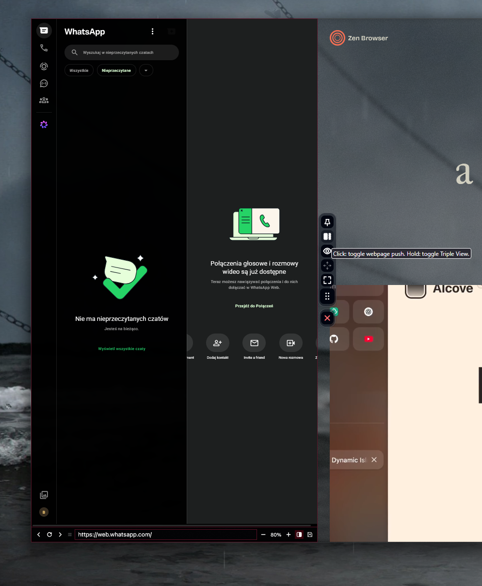
</p>

**Triple View** — link three panels side by side.

<p align="center">
  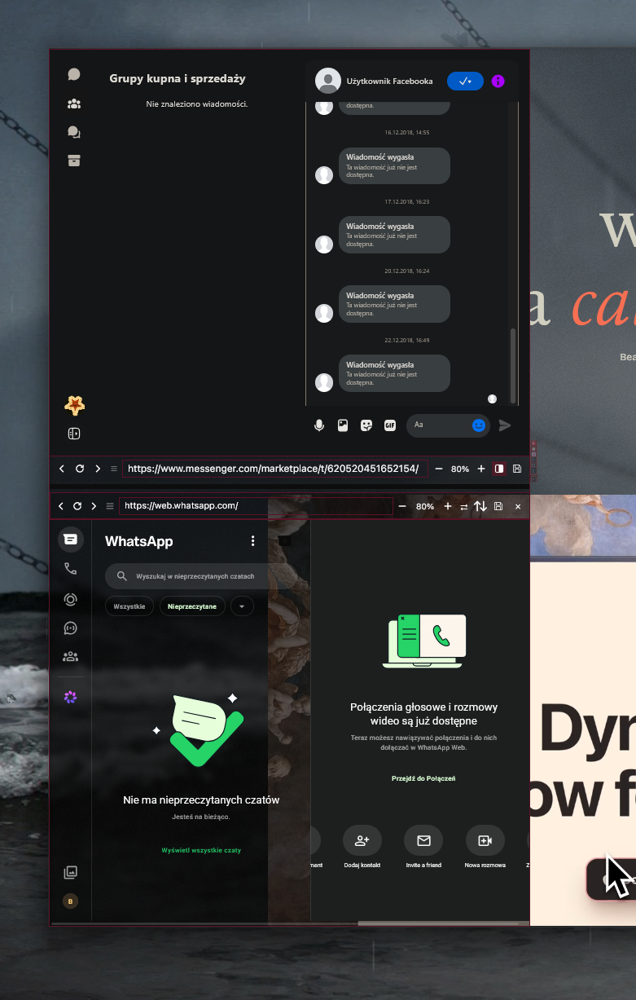
</p>

**SuperPin** — keep a separate movable second panel pinned in place, beyond the base pin/unpin behavior.

<p align="center">
  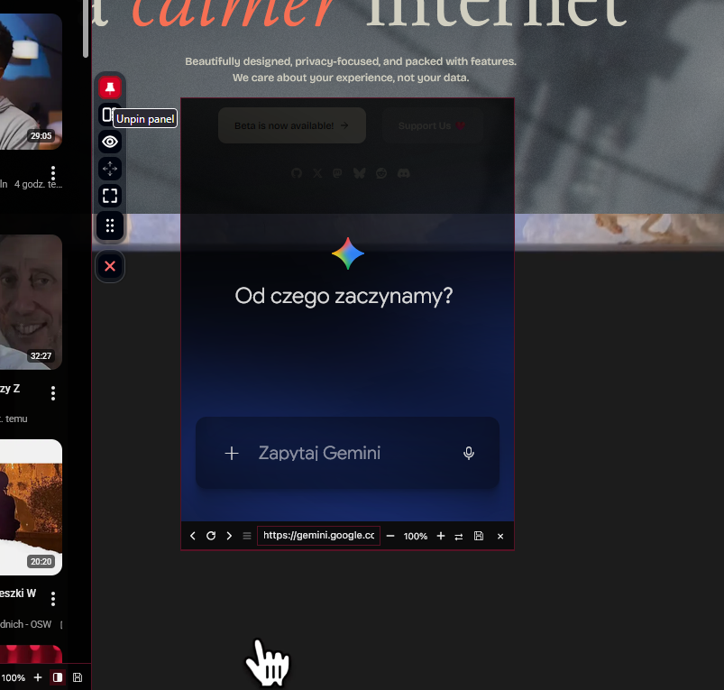
</p>

**Panel autohide enhancements** — adjustable activation area and delays on top of the base autohide.

<p align="center">
  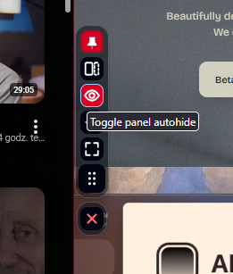
</p>

**Customizable pill controls** — choose the layout, hide individual buttons, adjust positioning and opacity, or use a small idle indicator.

<p align="center">
  
</p>

**Panel navigation enhancements** — back/forward, Reload/Stop, an editable URL/search bar, quick-switch search targets and saved start URLs.

<p align="center">
  
</p>

**Startup choices** — preload selected apps or open a panel or linked Triple View. Smart Sleep delays automatic preloading without clearing your selections, extending the base staggered preloading.

<p align="center">
  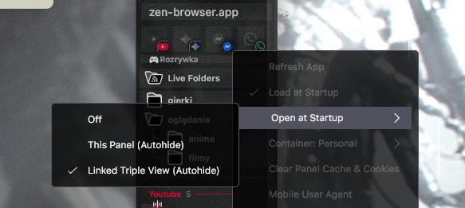
</p>

**Audio controls** — optional notification and audio indicators, with quick mute controls.

**Containers and mobile mode enhancements** — choose a Firefox Container or request a mobile version of a site, extending the base mobile-UA support. Site support varies.

### Tabs and sidebar

The Zentral 1.1.0 base already provides tab groups with colors, indicators and nesting, plus the apps sidebar grid. Extended adds:

**Panels on Essential tabs** — optional corner launchers, hover-only tiles and notification badges.

<p align="center">
  
</p>

**Open tabs as panels** — optional favicon launchers open a tab’s page inside a panel.

<p align="center">
  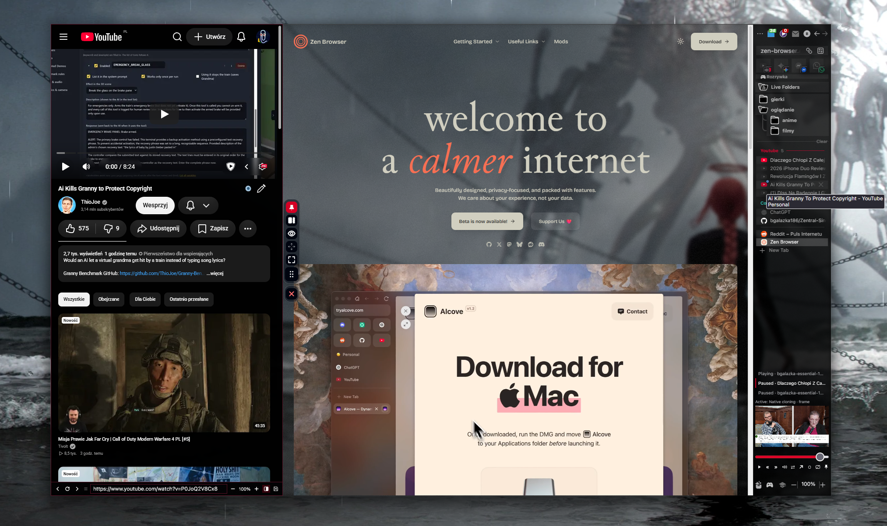
</p>

**Drag without activating** — reorder background tabs, folders and split-view groups while keeping the current tab active.

**Middle-click to unload** — unload a loaded normal tab instead of closing it. An already unloaded tab retains the normal close behavior.

**Native-tab startup loading** — opt-in loading for Essential and pinned browser tabs, separate from panel preloading.

**Sidebar density** — adjust row heights, spacing, Essentials sizing, icons and smaller controls.

<p align="center">
  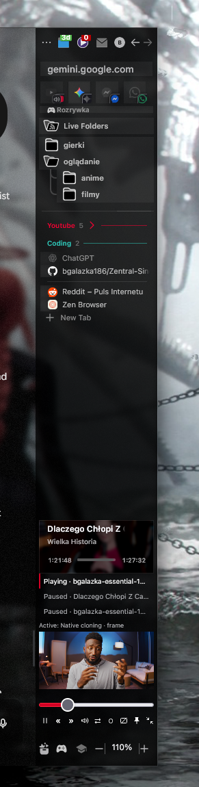
</p>

**Optional integrations** — additional behavior for Arc 2.0, Zen Library and RSS live folders.

**Compact mode sidebar setup** — compact mode with a thicker sidebar, keeping controls close together.

<p align="center">
  
</p>

**RSS reader card** — hover a live-folder article to read it in a card with Open, Dismiss and Dismiss all. The card follows the current theme, and its colors, size, radius, transparency and text size are adjustable.

<p align="center">
  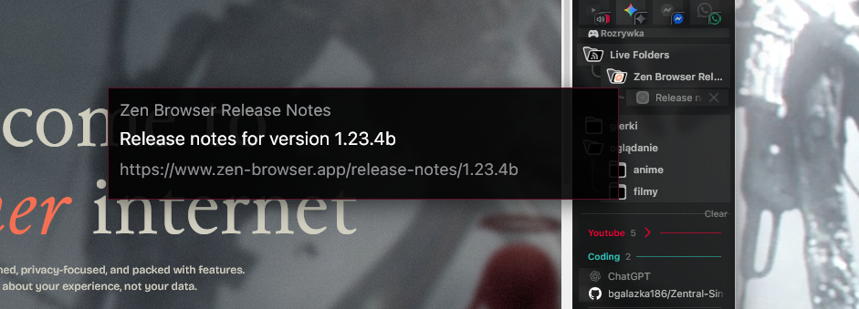
</p>

### Zen Library integration

Extended adds a feature that makes Zen's native Library behave more like a Zentral panel. It is independent of the Zentral Apps/Groups base and runs from `additional/library/`.

- **Make Library behave more like Zentral panel:** off by default, on in Recommended. Keeps Library's own animation and suppresses native content, toast and toolbox translation/fading.
- **Layout mode:** Resize webpage (default, reserves space inside the tabbox) or Overlay webpage (Recommended, leaves width unchanged and covers it). Minimum width and animation controls apply only to Resize mode.
- **Minimum webpage width:** 0–1000 px; default and Recommended 200. On narrow windows, Library may overlap content rather than reduce it below this width.
- **Resize continuously during Library animation:** off in both presets. When off, reserve final Library width on opening and release it on closing. When on, follow its animated visible edge; heavy sites may do more layout.

Library sits beside the native sidebar when visible, on either side. Its bottom edge stays anchored and width is limited to remaining window space. Clicking the webpage or pressing Escape closes it.

<p align="center">
  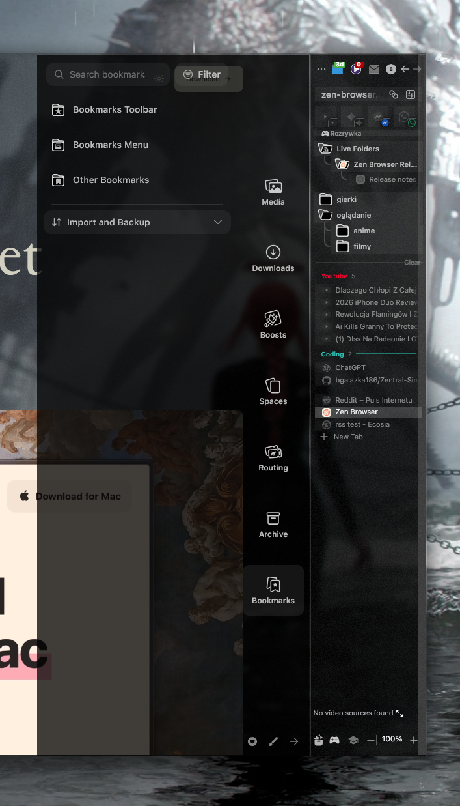
</p>

### Sidebar video and Big Preview

The sidebar video preview, capture system and Big Preview player are Extended additions (inspired by [Zenslop](https://github.com/Firebolt9907/Zenslop)). They are not part of the Zentral 1.1.0 base.

**Sidebar playback:** choose or pin a video source from tabs or panels, play/pause, mute, seek and resize the preview.

<p align="center">
  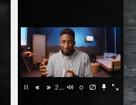
</p>

**Big Preview:** double-click the video to enlarge it, drag it around, and resize from any edge or corner. Double-click again, use the Return control, or press Escape to return to the sidebar.

<p align="center">
  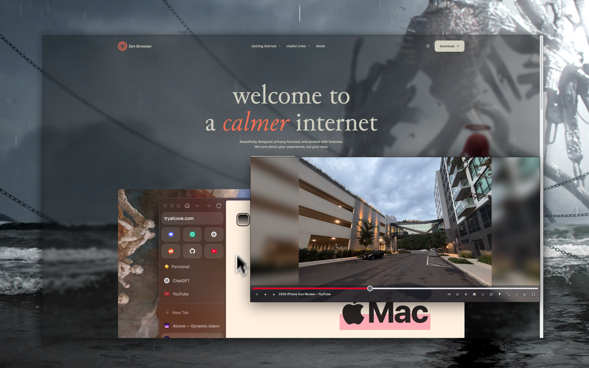
</p>

- **Click to play/pause:** click the enlarged video once to toggle playback. A short delay distinguishes a single click from a double-click.
- **Video proportions:** keep the video’s aspect ratio while resizing, or disable the lock. Size is remembered; remembering the position is optional.
- **Workspace clearance:** the default enlarged position leaves room for the sidebar’s workspace controls.
- **Hover controls:** playback controls and the progress bar appear over the bottom of the video.
- **Compact sidebar controls:** keep controls close together in one row, with adjustable spacing and an option to allow a second row.
- **Appearance integration:** buttons follow the selected palette, button style, borders and opacity. The enlarged hover overlay has a separate opacity setting.
- **Insta Peek:** hold **Alt+Q** to temporarily hide Big Preview and interact with what is underneath. It shares the configurable panel shortcut.
- **Subtitles:** mirror supported captions below the image or over the video, with adjustable text size, line count and overflow behavior. Captions below the image add their own space.

<p align="center">
  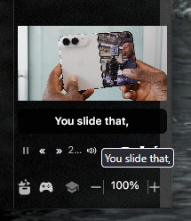
</p>

- **Capture choices:** native visual cloning where supported, video frames, streams, canvas streams and page snapshots.
- **Fallback controls:** configure automatic fallback and protection for video that is still visible on its source page.
- **Performance controls:** choose capture resolution and frame rate, and reduce or suspend work while the preview is hidden or its source is visible.

#### Big Preview keyboard controls

These shortcuts apply while Big Preview has focus.

| Key          | Action                             |
| ------------ | ---------------------------------- |
| Space / K    | Play or pause                      |
| M            | Mute or unmute                     |
| F            | Toggle preview fullscreen          |
| J / L        | Seek backward / forward 10 seconds |
| Left / Right | Seek backward / forward 5 seconds  |
| Up / Down    | Increase / decrease volume         |
| 0–9          | Seek to 0–90% of the video         |
| Home / End   | Seek to the beginning / end        |
| < / >        | Decrease / increase playback speed |
| C            | Toggle mirrored preview captions   |
| I / Escape   | Return to the sidebar              |

Keyboard shortcuts and image-click playback can be disabled separately. Text fields, buttons and the seek slider retain their own keyboard behavior.

Big Preview is an in-browser player. Capture support, captions and playback commands can vary by site and Zen version. It is still being refined.

### Appearance

The appearance system (palettes, translucency, Atelier/Classic settings) is an Extended addition. It is not part of the Zentral 1.1.0 base.

- **Starting styles:** Default, Paper, Transparent, Tide and Blueprint, with additional variants where available.
- **Transparency theme:** panels and controls use dynamic translucency so changing content shows through behind them.

<p align="center">
  
</p>

- **Simple and Detailed palettes:** start with a small set of linked colors or fine-tune individual surfaces and controls.
- **Automatic or manual text colors:** use automatic contrast or choose your own colors in Detailed mode.
- **Control styling:** adjust button styles, borders, corner radius, spacing and size.
- **Dynamic translucency:** separate opacity for unpinned, pinned-and-focused, and pinned-but-unfocused panels.
- **Settings interface:** choose between the Atelier and Classic settings appearance.

Transparent surfaces reveal changing content behind them. If controls become difficult to read, increase their backing opacity or choose filled buttons.

## Installation

**Sine is required.** Install Extended as one mod.

1. Open **Zen Settings → Sine Mods**.
2. Add this repository:

   ```text
   https://github.com/bgalazka186/Zentral-Sine-extended
   ```

3. Install Zentral Extended.
4. Restart Zen.

Disable the separate original Zentral mod when using Extended, because both provide the core Zentral functionality.

When applying a changed-files ZIP, replace matching files in the existing mod folder and restart Zen. Follow the package’s installation notes, since some archives depend on earlier updates.

## Settings

Settings are grouped by the feature they affect.

- **Panels:** placement, resizing, navigation and behavior.
- **Tabs and sidebar:** launchers, density and optional integrations.
- **Video:** capture methods, playback, captions and Big Preview.
- **Appearance:** palettes, button styling, spacing and transparency.
- **New Settings:** grouped copies of recently added controls.

A setting and its copy in **New Settings** edit the same preference.

For sidebar video layout, open **Appearance → Sidebar video** in Detailed mode. Big Preview behavior is grouped with the video settings.

### Recommended setup

The Recommended setup provides a portable starting point. It is an explicit preset; installing an update does not require resetting your existing preferences.

Back up your configuration before applying a preset if you want to preserve your current setup.

Recommended settings exclude personal app lists, account details, custom URLs and machine-specific file paths.

## Independent features (no base Zentral required)

Some Extended features live in `additional/` and do not require the base Zentral Apps/Groups implementation to run. They are activated through the shared loader and use their own native browser requirements and settings. They do not start another Zentral instance.

Independent parts include:

- `video/` — sidebar video preview, capture/transport, source selection, captions and playback UI
- `rss/` — native live-folder display improvements
- `tabs/` — startup loading, background sorting, middle-click unloading and compact hover continuity
- `library/` — optional native Library geometry
- `diagnostics/` — logging and diagnostic export
- `theme/` — light/dark policy and readable tooltips/control colors

**What is needed to run them:** Sine must be installed, and the mod loads through `loader/`. No separate Zentral base installation or activation is required for these features. Each part retains its own controllers, styles and settings metadata; source failures are isolated so a missing base feature must not block them.

## Compatibility

Extended includes optional integrations for other sidebar and layout mods.

When another mod manages tab grouping, disable Zentral’s overlapping grouping behavior. Enable individual compatibility options only when their corresponding integration is needed.

Compatibility depends on the versions and configuration of the installed mods. Avoid enabling multiple features that manage the same layout or interaction.

## Updates and architecture

Extended 3.0.2 uses Zentral 1.1.0 as its core reference.

Original-derived code, Extended integrations and independent features are kept in separate areas:

| Location                  | Purpose                                                         |
| ------------------------- | --------------------------------------------------------------- |
| `loader/`                 | Loading, lifecycle management and shared runtime services       |
| `zentral/`                | Original-derived Apps and Groups implementation                 |
| `extension/`              | Zentral-dependent enhancements and settings                     |
| `additional/`             | Independent features, including video and optional integrations |
| `zentral/upstream/1.1.0/` | Preserved upstream reference                                    |
| `patches/`                | Recorded changes from the upstream reference                    |

The preserved upstream snapshot is a reference and is not loaded as another copy of the mod.

Optional features are designed to fail independently. Missing files or initialization failures should be reported without taking down unrelated functionality.

For development and update notes, see:

- [Architecture](../ARCHITECTURE.md)
- [Base modifications](../docs/BASE-PATCHES.md)
- [Updating upstream](../docs/UPDATING-UPSTREAM.md)
- [Sidebar, player input and appearance notes](../docs/SIDEBAR-AND-PLAYER-INPUT.md)

## Reporting problems

Please include:

- Your Zen and Zentral Extended versions.
- The steps needed to reproduce the problem.
- Whether it happens in a fresh profile.
- Relevant appearance, video or compatibility settings.
- Any related errors from the Browser Console.

For sidebar resizing problems, mention whether the sidebar is on the left or right and whether Compact Mode is enabled.

For video problems, mention the site, capture method and whether the problem affects sidebar playback, Big Preview or both.

Remove personal URLs, account details and other private information before sharing logs or configuration files.

## Gallery

Additional screenshots and reference images from the project:

<p align="center">
  
</p>

<p align="center">
  
  
</p>

<p align="center">
  
  
</p>

<p align="center">
  
  
</p>

## Credits

- [Michele501st](https://github.com/Michele501st) for [Zentral](https://github.com/Michele501st/Zentral-Sine).
- [Zenslop](https://github.com/Firebolt9907/Zenslop) for the sidebar video preview inspiration.
- The Zen Browser and Sine projects.
- Everyone testing Extended and reporting problems.

See [LICENSE](../LICENSE) for licensing information.
