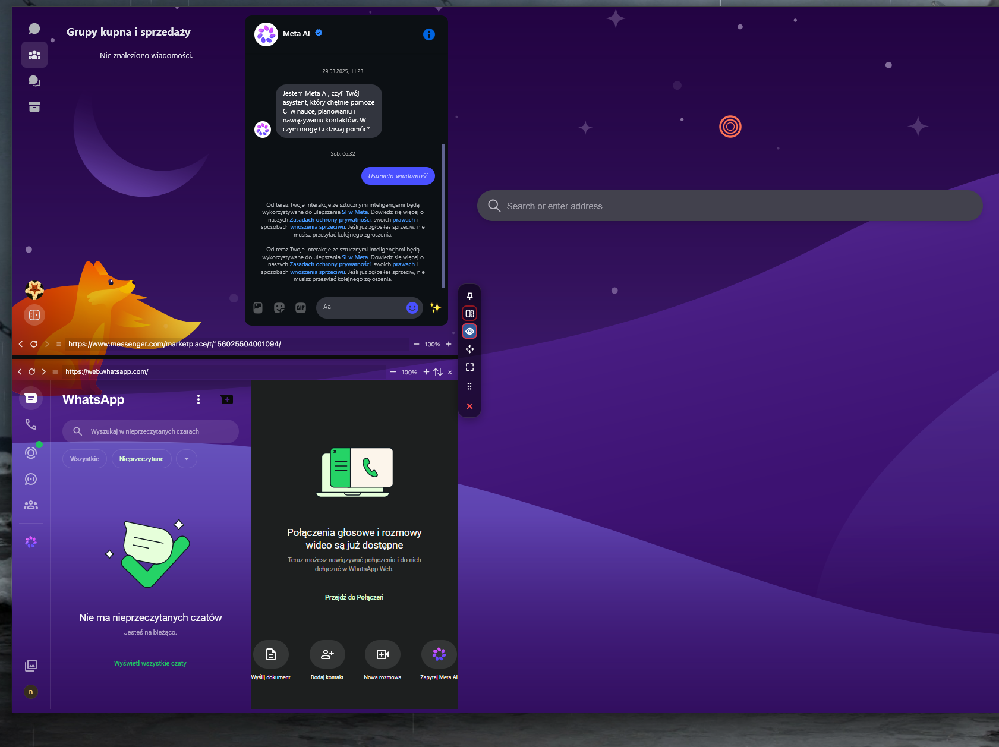
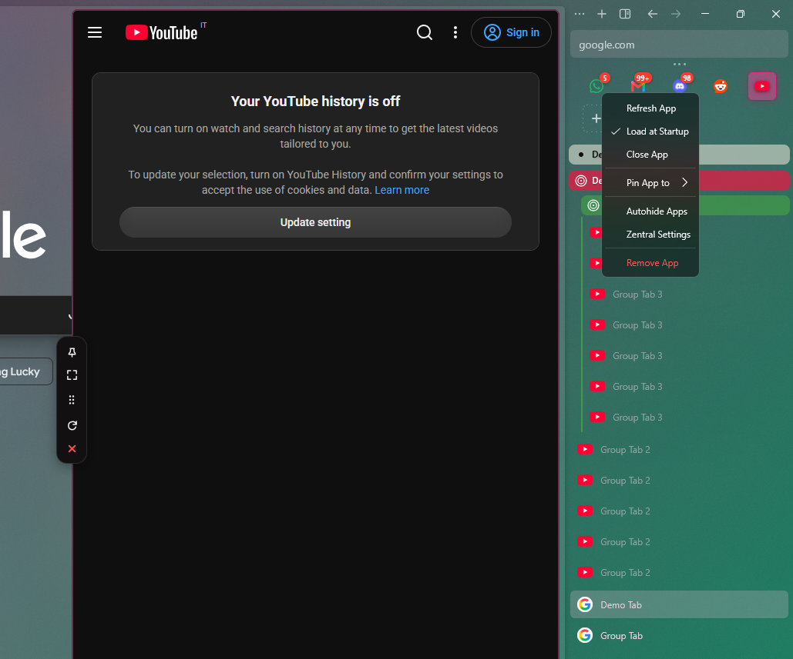
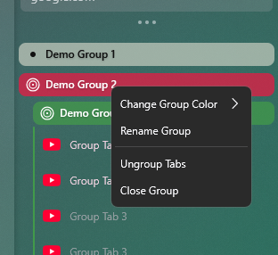
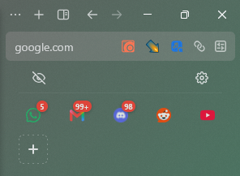
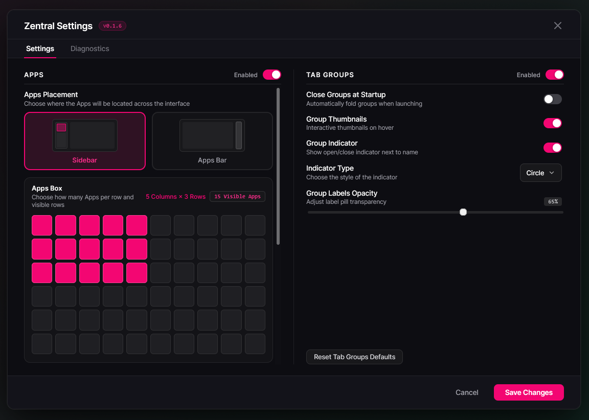

<p align="center">
  <b>This is my personal AI slop extended version of Zentral if you dont need any of those tweaks its better that you will use Michele501st/Zentral-Sine </b>
  <br>
</p>

<p align="center">
  
</p>

---

### Extra Features:

This fork has grown quite a bit beyond the original tweaks. Most extras can be configured in **Zentral Settings**; experimental options are marked separately.

#### Panels, layout and navigation

- **Appearance and linked colors:** five starting styles: Default, Paper, Transparent, rounded Tide and outlined Blueprint. Pick a theme, adjust the Simple palette, then switch to Detailed to fine-tune a copy of the current look. Themes set colors, web backing and decoration; Layout & density stays independent. Transparent starts with 90–95% transparent surfaces and low readability strength. Its variant dropdown offers Original and Crimson Glass; the latter adds near-black navy, crimson accents and minimal backing, based on the saved custom look. Existing profiles keep their saved settings until you choose a preset. Full settings import/export is at the top of settings, alongside Restore defaults and Apply recommended settings. Recommended uses the bundled custom configuration, including its appearance and layout, without personal URLs, paths, local registrations or screen-specific offsets; both presets preserve saved apps, groups and panel assignments. Restart after changing behavior or module settings. Settings controls are assembled in a fixed order before categories are arranged; missing optional sections cannot interrupt the window.
- **Dynamic translucency:** separate opacity levels for unpinned, pinned-and-focused, and pinned-but-unfocused panels, plus optional black backing for readability.
- **Opposite-side docking and edge attachment:** keep launchers in the normal sidebar while opening panels on the other side, or attach panels to the adjacent bar/window edge.
- **Move and resize panels:** drag panels in two dimensions, resize from multiple sides, and adjust horizontal offsets, vertical position, and top/bottom height. Still no 3D, sorry.
- **Dual View, Triple View and SuperPin:** push the webpage aside with Dual View, use two panels in Triple View, or keep a separate movable second panel with SuperPin. Hold the Dual View or Pin button, then choose another panel. Triple View has its own webpage-push choice, divider, swap and close/unlink controls.
- **Panel autohide:** keep an app loaded while hiding its panel until needed. Adjust the reveal delay, activation width and hide delay; choose whether the inside hover area should reveal it. The space reserved beside the webpage is controlled separately from the hover activation width.
- **Pill menu customization:** hide individual buttons or the whole pill, adjust its position and opacity, or use a small idle indicator when the full menu is too much.
- **Navigation, search and zoom in panels:** back/forward, reload, an editable URL/search bar, zoom controls, custom search templates and quick-switch search targets. Place the toolbar at the top or bottom, or show it only on hover. Panel zoom is saved per panel, including essential-linked panels, and restored after restart.
- **Load and open Zentral panels at startup:** in a panel launcher's context menu, **Load at Startup** loads its app in the background. The separate **Open at Startup** submenu selects a panel or an existing linked Triple View to open with Autohide; panel Autohide must be enabled. **Smart Sleep** delays automatic preloading rather than cancelling your startup selections.
- **Panel audio controls:** optional audio indicators and quick mute controls, so a noisy panel does not need a full visit just to silence it.
- **Firefox Containers and mobile mode:** choose a container or switch a panel's user agent to mobile. **Clear Panel Cache & Cookies** clears the configured site's cookies and caches within that container, so other tabs or panels sharing that site and container can be affected. Changing the user agent does not guarantee a mobile layout.

#### Tabs and sidebar

- **Panels on Essential tabs:** place corner launchers on Essentials, with optional hover-only tiles and notification badges. I still recommend arranging your panels to match your Essentials before enabling this.
- **Open tabs as panels:** optional favicon launchers let you open a tab's page in a panel. Mods that put another action on the favicon may conflict with this.
- **Drag without activating tabs:** reorder background tabs, folders and split-view groups while keeping the current tab active and sleeping tabs asleep. Normal clicks still select tabs.
- **Middle-click to unload:** optionally unload a loaded normal tab instead of closing it. Middle-clicking an already unloaded tab keeps the normal close behavior.
- **Optional native-tab startup loading:** a separate, opt-in **Load at Startup** item in Essential and pinned-tab context menus wakes selected sleeping browser tabs after session restoration. This is independent of the Zentral panel startup controls above.
- **Sidebar density and appearance:** compact tabs and folders, adjustable row heights and spacing, Essentials sizing, icon sizes and smaller sidebar controls. Optional Arc 2.0 appearance tweaks cover the regular sidebar and Zen Library; RSS tweaks can hide empty live folders and compact their headers.

#### Sidebar video

- **Video preview and playback controls:** preview a page's video in the sidebar, select or pin a source, seek through playback, mirror supported captions, resize the preview, or switch to a compact card. The idea was inspired by Zenslop's video preview; credit to them.
- **Native video cloning:** show the source video's decoded output directly in the sidebar using Firefox's native visual cloning, where supported. This preserves source quality without repeatedly capturing still images.
- **Video frames and other renderers:** Video Frames builds the preview from repeated captures of the current video frame, with adjustable capture rate and resolution. Direct video streams, canvas streams and page snapshots provide other rendering or fallback choices.
- **Renderer and performance choices:** automatic or selected preview methods, fallback options, capture size/rate controls and settings to reduce or suspend work while the preview/sidebar is hidden. Different sites and video sources can behave differently.

#### Settings and compatibility

- **Customizable settings interface:** choose Atelier or Classic styling and adjust colors, opacity, borders, corner radius, spacing and control styles.
- **Settings backups:** import/export the look separately or back up all supported settings, so a setup is easier to keep and reuse.
- **Shortcuts and input protection:** configurable panel shortcuts for closing, navigation, zoom and layout actions. Enabling these shortcuts also enables the input shield, which routes supported navigation inputs to the panel and guards against actions reaching the main tab. Disabling shortcuts does not automatically disable the shield.
- **Add-on compatibility options:** optional real tab IDs for web panels, an inspection folder for their host tabs, and an experimental Zen Internet CSS workaround. These improve specific integrations; they do not make every add-on compatible.
- **Optional feature management:** developer controls can disable optional modules and styles, with diagnostics available for troubleshooting. Core dependencies remain protected unless the explicit unsafe override is enabled.
- **Changed mod files structure** now it should be easier for anyone who wants to get some parts of it and add to their own setup :D

### Experimental Features (Advanced Settings):

These options are experimental and separate from the regular hover behavior. Availability and reliability can depend on Zen and the pointer events it delivers.

- **Outside-window panel reveal:** optionally reveal an already open autohidden panel when leaving through its docked window edge, with outside-pointer tracking where supported and timed hiding as a fallback.
- **Compact tab sidebar hover stabilization:** under **Advanced → Experimental**, **Stabilize Compact Tab Sidebar Hover (Experimental)** is the master switch for the compact-sidebar hover enhancements and the optional return-reveal behavior below. Turn it off to disable this group if a browser update causes trouble.
- **Reveal on return, with brief protection:** an optional enhancement reveals the tab sidebar when the cursor returns through its side of the window and briefly protects it from hiding during a quick out-and-back movement. It keeps the normal hover activation area unchanged, but cannot guarantee that every crossing will be detected.
- **Matching panel behavior:** optionally apply return reveal to already open autohidden panels too. A separate restriction, enabled by default, limits this enhancement to panels that are not pushing the webpage. Both options depend on the master switch above; the separate outside-window panel reveal setting remains independent.

### Extra Bug Fixes:

- **Right-click menus closing panels:** fixes the original issue where opening a right-click menu closed the panel.

### Example setup

<p align="center">
  
</p>

<p align="center">
  
</p>

---

### Future Roadmap:

- **Whatever i will want for myself:** if you want to add something/ have proposition give Michele501st (they know what they are doing way more then me) details, if the proposition seems more like something for this extension then main mod, i will be glad to see what i can do

- **Other mods i do use and there propably never be an issue with it:**
  - Arc 2.0
  - Better CtrlTab
  - Customize Font Size
  - Transparent Zen
  - Zen Folder Tree Connectors

---

## ⚖️ Attribution, Upstream Credits & Disclaimer

- **Original Creator & Project:** This project is an independent fork and extension of **[Zentral](https://github.com/zen-browser)** for Zen Browser, originally developed under the **CC BY-NC-SA 4.0** license. All original code, branding, and core architecture belong to the original author.
- **Modifications:** This repository introduces experimental modifications (the _Bgalazka Extension_ layer) including opposite-side docking overrides, corner-docked essential tab tiles, and custom translucency profiles.
- **Support the Original Dev:** If you enjoy Zentral, please support the original author via their Ko-fi / upstream channels linked in the settings menu.
- **Bug Reports:** **Do not open issues on the upstream Zentral repository for problems encountered while using this fork.** Please file all issues, bugs, and feature requests directly in this repository's Issues tab.
- **License:** Licensed under [Creative Commons Attribution-NonCommercial-ShareAlike 4.0 International (CC BY-NC-SA 4.0)](https://creativecommons.org/licenses/by-nc-sa/4.0/).

> **Original Zentral documentation:** The **Overview and all sections below it** are retained from Zentral before this fork. My additions are documented above. The inherited text is preserved as an upstream reference; its installation links, version references and repository layout may differ from this fork.

<p align="center">
  
</p>

<h1 align="center">Zentral</h1>

<p align="center">
  <b>Unified Web Apps Grid, Floating Side Panels & Enhanced Tab Groups for Zen Browser</b>
  <br>
</p>

<p align="center">
  <a href="theme.json"></a>
  <a href="https://zen-browser.app/"></a>
  <a href="theme.json"></a>
  <a href="https://ko-fi.com/michele501st"></a>
  <a href="LICENSE"></a>
</p>

---

## 📖 Overview

**Zentral** unifies your favorite communication tools, web applications, and tabs into a cohesive, fluidly animated sidebar experience.

<p align="center">
  
</p>
Designed natively for the **Sine Mod Engine**, Zentral features hot-reloading support (`supportsUnload: true`), declarative settings UI, session persistence, automatic high-contrast color calculations, and lightweight Gecko performance with zero external dependencies.

---

## ✨ Key Features & Deep Dive

<details>
<summary><b>🗂️ 1. Tab Groups & Organization</b></summary>
<br>

Zentral significantly expands Zen Browser's native tab group capabilities with styling, smooth interactions, and rich color customization:

<p align="center">
  
</p>

- **🎨 Multi-Mode Color Picker Panel**:
  - **Quick Swatches**: 25 color presets.
  - **2D Spectrum Canvas**: Interactive Saturation-Value box with a 360° Hue slider.
  - **System Eyedropper Tool**: Direct screen color sampler (via native `EyeDropper` API).
  - **Direct Hex & RGB Inputs**: Live dual-way input fields.
  - **Auto Average Favicon Color**: Automatically extracts the average color from group tab favicons in a click.
- **🏷️ Collapsed Sidebar Marquee Carousel**:
  - In Collapsed Sidebar mode, resting state displays clean, non-truncated initials or title text.
  - On hover, starts a looping horizontal scrolling marquee for long names.
- **🔘 Open/Close Indicators**:
  - Toggle and customize group indicators between **Circle Dots** (inspired by Zen logo) and **Chevron Arrows**.
- **🌳 Deep Hierarchy & Nesting**:
  - Full support for multi-level nested tab groups with proper indentation and drag-and-drop support.
  - Native Zen Split Views inside groups drag as unified items.
- **🛡️ Tab Selection & Drag Guard**:
  - Drag and Drop for dormant tabs without waking them up during reordering.
- **📁 One-Click Zen Folder Conversion**:
  - Right-click any folder in your sidebar to convert it to a Tab Group.
- **💾 Full State Persistence**:
  - Persists custom colors, group labels, collapsed states, and nesting structures across browser reboots and workspace switches via Firefox SessionStore.

</details>

<br>

<details>
<summary><b>📱 2. App Box and App Bar & Multi-Instance Web Panels</b></summary>
<br>

Keep your essential web apps (Discord, WhatsApp, Reddit, Spotify, Notion, YouTube, etc.) one click away without cluttering your tab strip:

<p align="center">
  
</p>

- **📍 Flexible Placement Modes**:
  - **Sidebar**: Embeds directly into Zen's sidebar with customizable grid in Zetral Settings.
  - **Vertical Edge Bar**: Standalone vertical dock positioned on the opposite screen edge from Zen's sidebar (left or right).
  - **Top Toolbar**: Compact top bar layout specific for the Collapsed Sidebar layout mode.
- **👻 Intelligent Autohide**:
  - Automatically collapses the floating App Bar or App Box when not in use; expands with smooth hover transitions when approaching the trigger edge.
- **🖼️ Native Zen Theme & Grain Integration**:
  - App Bar matches Zen Browser's active theme gradient and film grain texture with rounded panel borders.
- **🎛️ Full Panel Controls**:
  - **Pin / Unpin**: Keep panels persistently open side-by-side with main web content.
  - **Dynamic Drag Resizing**: Smooth draggable edge resize handle with per-app width memory.
  - **Expand to Full Width**: Maximize panels instantly.
  - **Refresh App**: Reloads the App when necessary.
  - **Close App**: Unloads App to free resources.
- **🌐 Workspace Isolation**:
  - Right-click any app button to choose to which Space pin the App.
- **🔔 Live Unread Notification Badges**:
  - Automatically parses unread message counts from page titles and renders clean overlay badges.
- **⚡ Staggered Background Preloading**:
  - Silently preloads active apps in the background for instant, zero-latency panel popups.
- **🌀 Panel Animation**:
  - Choose between **Smooth Slide**, **Gentle Spring**, **Bouncy Spring**, or **Elastic** transitions.

</details>

<br>

<details>
<summary><b>⚙️ 3. Sine Preferences & Customization Options</b></summary>
<br>
<p align="center">
  
</p>

All preferences are declaratively registered via [`preferences.json`](preferences.json) and customizable live inside **Zen Settings -> Mods -> Zentral**:

| Setting Property                             | UI Label                          | Type       | Default         | Description                                                               |
| -------------------------------------------- | --------------------------------- | ---------- | --------------- | ------------------------------------------------------------------------- |
| `zen.workspace.apps.sidebar.enabled`         | Enable Apps Sidebar Grid & Panels | `checkbox` | `true`          | Master switch for the Apps Grid module                                    |
| `zen.workspace.apps.sidebar.apps_per_row`    | Apps Displayed Per Row            | `dropdown` | `7`             | Number of columns in grid mode (3–10)                                     |
| `zen.workspace.apps.sidebar.max_rows`        | Maximum Grid Rows                 | `dropdown` | `3`             | Maximum visible grid rows before scrolling (1–5)                          |
| `zen.workspace.apps.sidebar.animation_type`  | Panel Animation Easing Curve      | `dropdown` | `spring-gentle` | Panel easing curve (`slide`, `spring-gentle`, `spring-bouncy`, `elastic`) |
| `zen.workspace.tabgroups.enabled`            | Enable Enhanced Tab Groups        | `checkbox` | `true`          | Master switch for enhanced tab group logic                                |
| `zen.workspace.tabgroups.collapse_on_launch` | Collapse Tab Groups on Startup    | `checkbox` | `false`         | Automatically collapse all groups on launch                               |
| `zen.workspace.tabgroups.show_chevron`       | Show Open/Close Indicator         | `checkbox` | `true`          | Display open/close pill indicator                                         |
| `zen.workspace.tabgroups.indicator_type`     | Tab Group Indicator Style         | `dropdown` | `circle`        | Indicator appearance: `circle` (Dot) or `chevron` (Arrow)                 |
| `zen.workspace.tabgroups.thumbnails`         | Show Tab Thumbnails on Hover      | `checkbox` | `true`          | Render live preview thumbnails on tab hover                               |
| `zen.workspace.zentral.debug`                | Enable Diagnostic Logging         | `checkbox` | `false`         | Enables real-time console tracing buffer                                  |

</details>

<br>

<details>
<summary><b>🩺 4. Built-in Diagnostics & Issue Reporter</b></summary>
<br>

Zentral includes a telemetry and diagnostics subsystem:

- **Hotkey Export (`Alt+L`)**: Press <kbd>Alt</kbd> + <kbd>L</kbd> anywhere in Zen to instantly generate and download a clean, structured diagnostic log.
- **Granular Module Tracing**: Independent toggles for Core engine, Tab Groups, Apps Bar, Context Menus, and Computed CSS layout logs.

</details>

---

## ⚡ Installation

### Method 1: Instant Install via Sine Mod Engine (Recommended)

1. In Zen Browser, navigate to **Settings** (<kbd>Ctrl</kbd> + <kbd>,</kbd>) → **Sine Mods**.
2. Paste the repository URL:
   ```text
   https://github.com/Michele501st/Zentral-Sine
   ```
3. Click the **Install** button.
4. Sine will automatically download, validate, and activate Zentral instantly!

---

<div align="center">

### ☕ Support the Project

</div>

<h5>If you enjoy using Zentral and would like to support its ongoing development, optimization, and new features, consider buying me a coffee! Every bit of support is deeply appreciated and helps keep the project active and independent.</h5>

<p align="center">
  <a href="https://ko-fi.com/michele501st" target="_blank">
    
  </a>
</p>

---

### Method 2: Manual Profile Installation

1. Locate your Zen Browser profile directory (`about:support` → **Profile Folder** → _Open Folder_).
2. Inside the profile, create or navigate to `chrome/sine-mods/`.
3. Clone or extract this repository into a folder named `zentral`:
   ```bash
   git clone https://github.com/Michele501st/Zentral-Sine.git "<profile-directory>/chrome/sine-mods/zentral"
   ```
4. Open Zen Browser and enable **Zentral** in your Sine Mod manager.

---

## ⌨️ Shortcuts & Hotkeys

| Shortcut                                  | Action                                                           | Scope                    |
| ----------------------------------------- | ---------------------------------------------------------------- | ------------------------ |
| <kbd>Alt</kbd> + <kbd>L</kbd>             | Export Zentral Diagnostic Log & Snapshot                         | Global Browser Window    |
| <kbd>Click</kbd> on Group Label           | Toggle Expand / Collapse Group                                   | Tab Strip / Sidebar      |
| <kbd>Right Click</kbd> on Group Label     | Open Zentral Custom Context Menu (Rename, Color Picker, Ungroup) | Tab Strip / Sidebar      |
| <kbd>Right Click</kbd> on App Tile        | Configure App Settings, Icon, Mobile Mode & Workspace Visibility | Apps Grid / Vertical Bar |
| <kbd>Right Click</kbd> on Bookmark Folder | Convert Folder to Tab Group                                      | Zen Sidebar              |

---

## 📂 Repository Structure

```text
Zentral-Sine/
├── theme.json            # Sine Mod manifest (ID, metadata, unload capability)-Changed to extended version manifest
├── preferences.json      # Declarative schema for native Zen settings UI
├── chrome.css            # Stylesheet overrides (glassmorphism, layout, animations)-extension CSS is added on bottom of this file
├── JS/
│   ├── Zentral.uc.js     # Master userChromeJS script (Apps, TabGroups, ColorPicker)-extension JS is added on bottom of this file
├── JS/
│   └── zentral_logger.uc.js # High-performance diagnostic logging engine
├── assets/
│   ├── Zentral Logo.png  # High-resolution raster logo
│   └── Zentral Logo.svg  # Vector branding asset
└── serverless/           # Issue reporter worker endpoint definition
```

---

## 📄 License

Distributed under the **Creative Commons Attribution-NonCommercial-ShareAlike 4.0 International License (CC BY-NC-SA 4.0)**.

- **Attribution**: You must give appropriate credit to the author ([Michele Pierini](https://github.com/Michele501st)).
- **NonCommercial**: You may not use the material for commercial purposes or bundling for sale.
- **ShareAlike**: If you remix, transform, or build upon the material, you must distribute your contributions under the exact same license.

See the [LICENSE](LICENSE) file for complete details.
